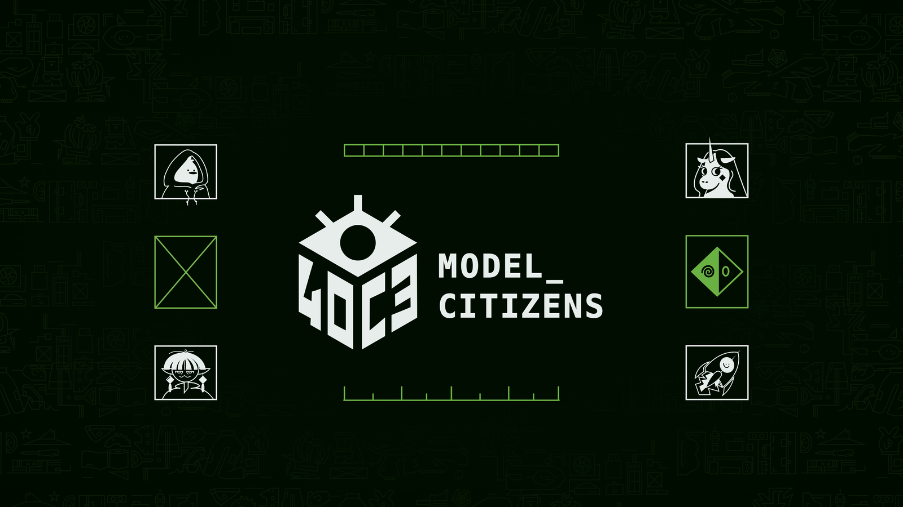

# WALL_PAPERS

Make your own **40C3 · MODEL_ CITIZENS** wallpapers, right in the browser:
your own two-line slogan, the eight CI colours (or any colour you like), your
own citizens in the boxes, and a layout that leaves room for the macOS lock
screen. Nothing is uploaded; the PNGs are rendered on a canvas on your machine.

**→ [lukas-runge.github.io/wall_papers](https://lukas-runge.github.io/wall_papers/)**



## What you can change

- **Slogan.** Two lines in Hack Bold next to the 40C3 cube, e.g. `SELF_ / HOSTED`
  or `ESC_ / REALITY`. Logo and text stay centred and the box columns keep the
  original gap to the text. Tip from experience: line 2 should be longer than
  line 1.
- **Colour.** The eight CI colours of the styleguide, or your own. The dark
  background is tinted to match: same chroma and same perceived lightness
  (Helmholtz–Kohlrausch corrected) as the original `#000d00`, hue of the
  accent. Green keeps the original values exactly.
- **Boxes.** Each of the six boxes takes one of the banner's line drawings, a
  citizen or an icon from the styleguide (recoloured to the palette), or stays
  empty.
- **Placement.** *macOS lock screen*: the banner sits between clock and login
  like on the original wallpaper. Off: banner and pattern are centred.
- **Size.** 8K like the 39C3/40C3 wallpapers, 5K, 4K, QHD, Full HD, the
  MacBook panels or anything up to 16384 px. Download one PNG or a ZIP of all
  selected colours.

The settings live in the URL, so a variant can be shared as a link.

## Faithful to the original

With the default settings the renderer reproduces the original 8K wallpaper:
mean difference 0.17/255 per channel, 0.16 % of the pixels differ by more than
32 levels (anti-aliasing along edges). The logo is `40C3_Logo_A.svg`, the
wordmark is live Hack Bold text with the original's hand-kerned glyph
positions, the pattern, oval mask and vignette follow the original generator.

## Development

Requires Node.js 26 LTS (`nvm use`) and pnpm.

```sh
pnpm install
pnpm dev          # http://localhost:5173
pnpm check        # svelte-check
pnpm test         # vitest
pnpm build        # static site in build/
```

`src/lib/generated/banner-parts.ts` is generated from the unmodified banner
SVG: `pnpm split-banner` (Python 3). CI fails if it is out of date.

| File | What |
|---|---|
| `src/lib/render.ts` | Canvas renderer: background, pattern, masks, banner, wordmark |
| `src/lib/banner.ts` | Builds the banner SVG from its parts, boxes, asset embedding |
| `src/lib/colors.ts` | CI palette and the background derivation |
| `src/lib/layout.ts` | Banner geometry, wordmark layout, placements |
| `src/lib/state.ts` | App state, URL hash, sizes, file names |
| `src/routes/+page.svelte` | The app |

Every push to `main` runs type check, tests and build, then deploys to GitHub
Pages ([.github/workflows/ci.yml](.github/workflows/ci.yml)). The base path
comes from the repository name, so renaming the repository just works.

## Credits

Design assets from the official 40C3 styleguide by the 40C3 design team, fonts
Hack and Jersey 10; see [NOTICE.md](NOTICE.md). Unofficial fan tool, not
affiliated with the CCC. Code: [MIT](LICENSE).
